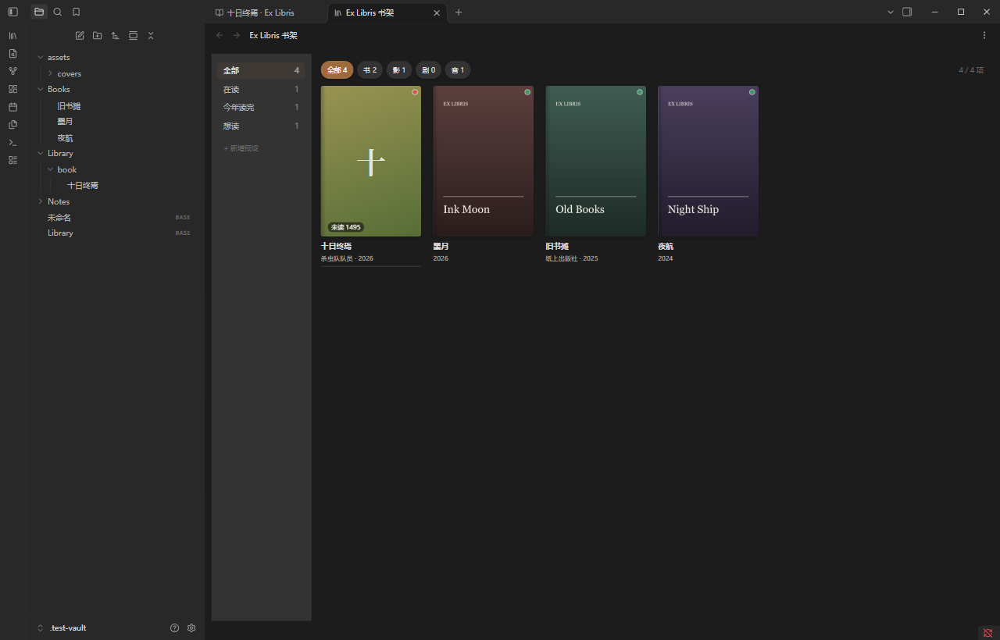
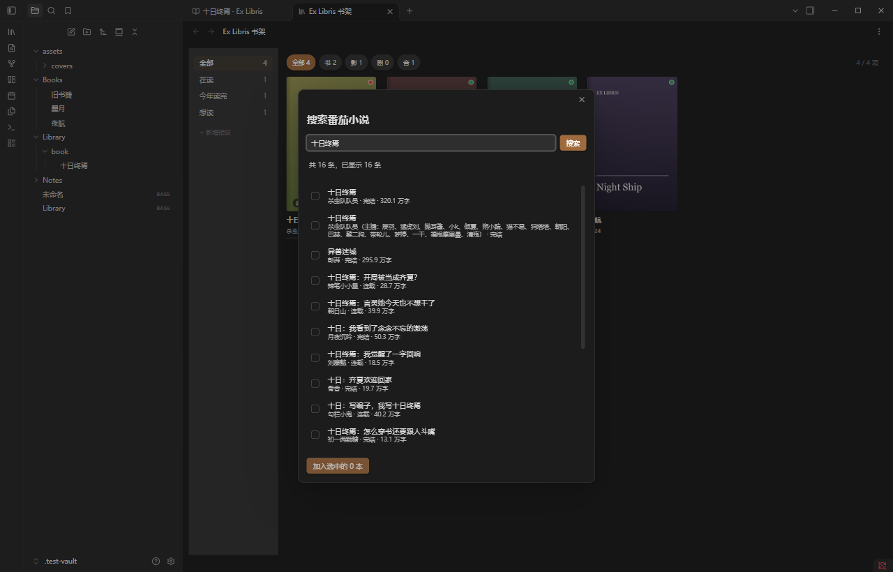
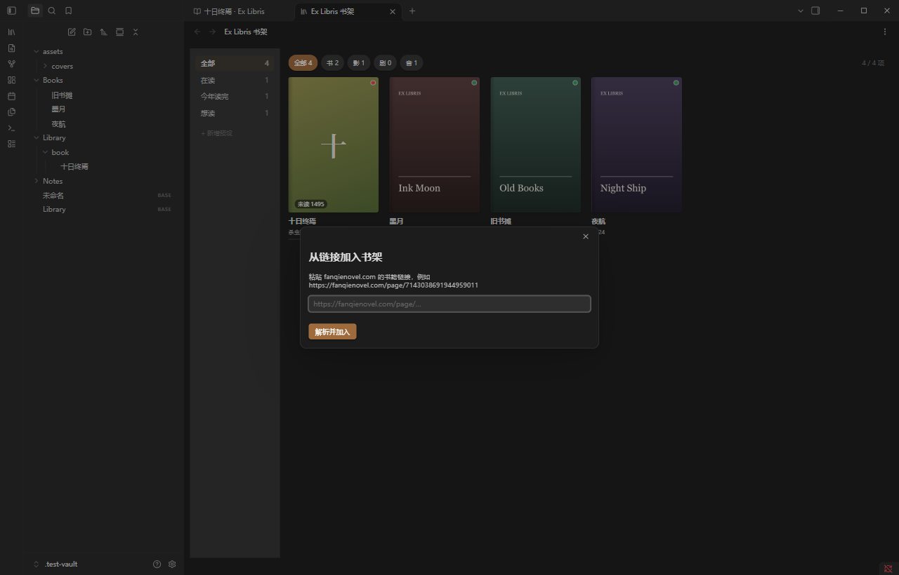
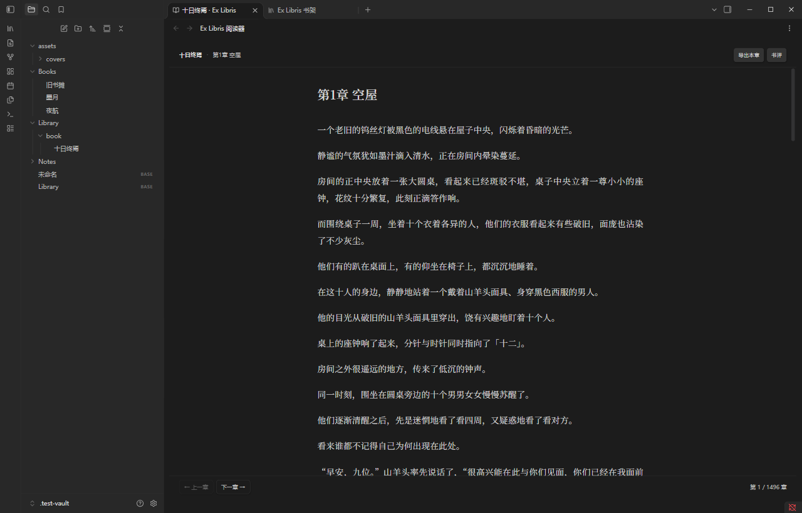
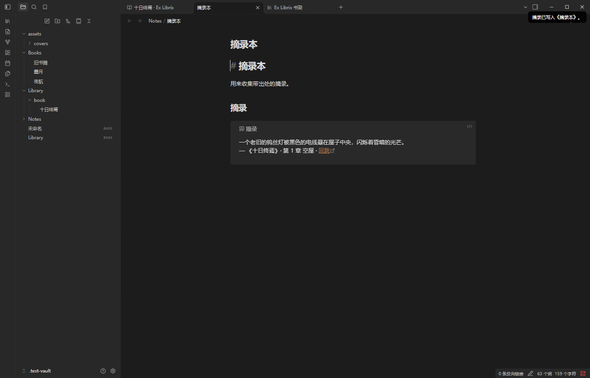
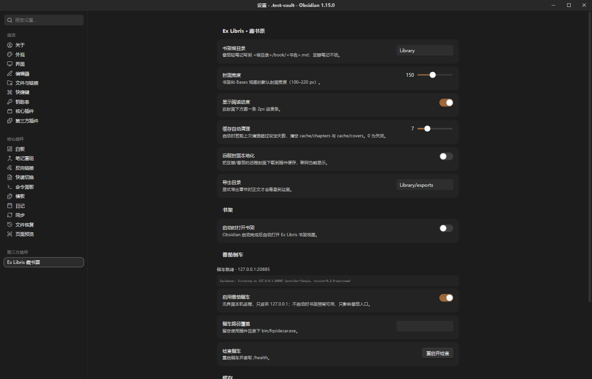
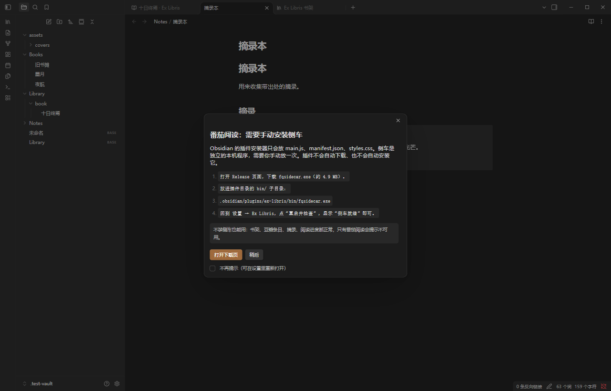

# 📚 Ex Libris Bookplate 🔖

<div align="center">


**把豆瓣与番茄，收进自己的书架。**
<sub>An iBooks-style bookshelf for Obsidian</sub>

[](https://github.com/Yolkbun/obsidian-ex-libris/releases/latest)
[](LICENSE)


[](https://github.com/Yolkbun/obsidian-ex-libris)
[](https://yolkbun.me/obsidian-ex-libris/)

</div>

## 🌌 引子

> “A room without books is like a body without a soul.”
>
> — Marcus Tullius Cicero

书架不只是文件的容器。它是你与读过的世界之间，一条可以走回去的路。

**Ex Libris** 是拉丁语“某某的藏书中”，指贴在书封内侧的那张小纸片——藏书票。
这个插件做的事就是同一件：把散落在豆瓣和番茄里的东西，一张一张盖上“我的”印章，收进自己的书架。

> **English**: Ex Libris Bookplate turns Douban and Fanqie into an iBooks-style shelf inside Obsidian.
> Search Douban without logging in, optionally read entries imported by `obsidian-douban`, read Fanqie
> chapters with excerpts and back-jumps, and export only when you ask. Local-first, no telemetry.

<details open>
<summary><b>📑 目录</b></summary>

- [🪶 关于这个项目](#关于这个项目)
- [✨ 项目特点](#项目特点)
- [🎨 效果展示](#效果展示) · [安装与运行](#安装与运行) · [使用方法](#使用方法)
- [🔗 豆瓣联动（可选）](#豆瓣联动可选)
- [🧱 边界与隐私](#边界与隐私)
- [🛠️ 开发与测试](#开发与测试) · [❓ 常见问题](#常见问题)
- [📜 许可证](#许可证) · [🎖️ 个人链接](#个人链接) · [🍁 致谢](#致谢)
- [🌍 English](#english)

</details>

---

## 🪶 关于这个项目

Ex Libris Bookplate 是一个 **Obsidian 桌面插件（Windows）**，把三种东西放进同一面书架：

1. **豆瓣**：书、电影、剧集。可以直接搜索加入，也可以联动 `obsidian-douban` 读取你原来的标记与评分。
2. **番茄小说**：搜索、目录、正文、书评、连载更新，全部在 Obsidian 里完成。
3. **你的笔记**：摘录带着书名、章节和一条 `obsidian://` 回跳链接，落进你指定的笔记。

它不是又一个“稍后读”列表，也不是下载器。它关心的是：**读过的书，能不能在需要的时候被重新找到。**

> 详细安装、字段、侧车与故障排查见 [**使用指南**](docs/使用指南.md)。

## ✨ 项目特点

| 能力 | 说明 |
|---|---|
| **iBooks 风格书架** | 2:3 封面、书脊、悬停、来源徽标、占位封面、阅读进度条 |
| **Bases 视图** | 注册 `ex-libris-shelf`，可在 `.base` 里选封面宽度与进度开关 |
| **豆瓣双通道** | 内建搜索（书/影/剧） + 可选联动 `obsidian-douban`（只读） |
| **番茄阅读器** | 38em 单栏、翻章、断点续读、书评、键盘快捷键 |
| **摘录回跳** | `Ctrl+Shift+E` 插入引用 + 出处 + `obsidian://` 回跳 |
| **可控导出** | 单章 / 整本；正文默认不落盘，只在导出时写入 |
| **连载追更** | 目录刷新间隔（0 = 每次打开都拉），或手动“刷新当前书目录” |
| **本地优先** | 无账号、无遥测；token 不落盘；侧车只监听 `127.0.0.1` |

## 🎨 效果展示

<table>
  <tr>
    <td width="50%"><br /><sub><b>iBooks 风格书架</b></sub></td>
    <td width="50%"><br /><sub><b>番茄搜索 / 批量加入</b></sub></td>
  </tr>
  <tr>
    <td><br /><sub><b>从链接加入</b></sub></td>
    <td><br /><sub><b>阅读器（真实番茄正文）</b></sub></td>
  </tr>
  <tr>
    <td><br /><sub><b>摘录带出处与回跳</b></sub></td>
    <td><br /><sub><b>设置与侧车状态</b></sub></td>
  </tr>
</table>

首次运行且没有侧车时，会弹一次可关闭的安装引导（可勾选“不再提示”，也可在设置里重新打开）：



> 截图来自测试 vault（Obsidian 1.15.0，Windows，100% 缩放）。截图中的标签仍显示旧中文名；
> `0.1.2` 起社区显示名改为 **Ex Libris Bookplate**（Obsidian 要求 Basic Latin）。

## 🚀 安装与运行

### 方式 A：Obsidian 社区目录（推荐）

在 Obsidian → 设置 → 第三方插件 → **浏览**，搜索 **Ex Libris Bookplate**，安装并启用。

### 方式 B：手动安装插件

从 [最新 Release](https://github.com/Yolkbun/obsidian-ex-libris/releases/latest) 下载三个文件：

| 文件 | 放到 |
|---|---|
| `main.js` | `<vault>/.obsidian/plugins/ex-libris/` |
| `manifest.json` | 同上 |
| `styles.css` | 同上 |

```text
<vault>/.obsidian/plugins/ex-libris/
  main.js
  manifest.json
  styles.css
  bin/fqsidecar.exe        # 可选，只有番茄阅读需要
```

然后在 Obsidian → 设置 → 第三方插件启用 **Ex Libris Bookplate**，重启 Obsidian。

### 番茄侧车（可选）

Obsidian 的安装器只会放三个插件文件，不会安装侧车。需要番茄阅读时：

1. 从 [`sidecar-0.1.0` Release](https://github.com/Yolkbun/ex-libris-sidecar/releases/tag/sidecar-0.1.0) 下载 `fqsidecar.exe`；
2. 放到 `<vault>/.obsidian/plugins/ex-libris/bin/fqsidecar.exe`；
3. 设置 → Ex Libris → **重启并检查**，显示“侧车就绪”。

> **它不会自动下载、自动安装或自动更新侧车。** 首次缺少侧车时只会弹一次安装引导；
> 不装也能用书架、豆瓣、摘录、进度和导出笔记，只有番茄阅读提示不可用。

### 从源码构建

```powershell
npm install
npm run build
powershell -NoProfile -File scripts/install.ps1 -VaultPath "D:\YourVault" -Enable
```

侧车源码、fqapp 适配层和构建脚本在独立仓库
[`Yolkbun/ex-libris-sidecar`](https://github.com/Yolkbun/ex-libris-sidecar)，本仓库不包含侧车源码和二进制。

## 📖 使用方法

### 添加新书

- **有链接**：`Ctrl+P` → **从链接加入书架**，粘贴 `fanqienovel.com/page/<id>`（整段分享文案也可以）。
- **只知道书名**：书架工具栏 **＋ 添加番茄书**，或 `Ctrl+P` → **搜索番茄小说并加入**；勾选批量加入，或右键单本加入。
- **豆瓣**：书架工具栏 **＋ 豆瓣**，或 `Ctrl+P` → **搜索豆瓣并加入**；支持书/影/剧，不需要 `obsidian-douban`，也不需要侧车。

加完若书架没显示，执行 **重建书架缓存**。重复书会跳过，不覆盖你改过的字段。
详细步骤见 [使用指南 §3 添加内容](docs/使用指南.md#3-添加内容)。

### 阅读、摘录与导出

| 操作 | 方式 |
|---|---|
| 翻章 | `←` / `→` 或 `j` / `k` |
| 导出本章 | `Ctrl+E` / 阅读器顶部按钮 |
| 摘录选中文字 | `Ctrl+Shift+E`，插入到 `## 摘录` 下 |
| 回跳原文 | 点摘录里的 `obsidian://ex-libris?...` 链接 |
| 导出整本 | 命令 **导出整本番茄书**（唯一会落盘正文的路径） |
| 连载更新 | 命令 **刷新当前书目录**，或设置 **目录刷新间隔** |

摘录格式：

```markdown
> [!quote] 摘录
> 正文一段……
> — 《十日终焉》· 第 1 章 空屋 · [回跳](obsidian://ex-libris?book=7143038691944959011&chapter=1)
```

### 常用命令

| 命令 | 作用 |
|---|---|
| `打开书架` | 打开书架视图 |
| `从链接加入书架` | 粘贴番茄链接 |
| `搜索番茄小说并加入` | 搜索 + 复选批量 + 右键单本 |
| `搜索豆瓣并加入` | 搜索豆瓣书/影/剧并加入书架 |
| `刷新当前书目录` | 立即重拉当前/选中番茄书的目录 |
| `重启番茄侧车` | 显示 `/health` 结果 |
| `导出当前章节` / `导出整本番茄书` | 导出正文 |
| `把番茄书挂靠到豆瓣条目` | 只写 `fq_related` |
| `添加书架预设` | 状态/类型/来源/标签 |
| `本地化所有远程封面` | 断网可读 |
| `清理章节与封面缓存` / `重建书架缓存` | 维护 |

### Bases

在 `.base` 里把视图类型选为 **Ex Libris 书架**；选项有 `coverWidth`（100–220）与 `showProgress`。
示例见 [`examples/Library.base`](examples/Library.base)。

## 🔗 豆瓣联动（可选）

两种豆瓣方式可以二选一，也可以共存：

| | 内建豆瓣搜索 | 联动 `obsidian-douban` |
|---|---|---|
| 登录豆瓣 | 不需要 | 需要 |
| 数据来源 | 公开搜索（书/影/剧） | 你标记过的书影音 |
| 状态/评分 | 默认 `想读` / `想看` | 保留原来的 `myState` / `myRating` |
| 网络 | 搜索时访问豆瓣 | 导入时由 douban 插件访问 |
| 写入 | 新建轻笔记 | **只读**，不改豆瓣笔记 |

开启方式：设置 → Ex Libris → **联动 obsidian-douban**（默认开启）。
关闭后只显示番茄条目和内建豆瓣搜索添加的条目（带 `ex_libris: douban-search`）。

完整步骤、字段映射、重复条目处理见
[使用指南 §3.3c](docs/使用指南.md#333c-联动-obsidian-douban可选)。

## 🧱 边界与隐私

### 有意为之的边界

1. **书评而不是段评。** 番茄段评需要正文 `item_version` 才返回内容；本项目用同一 App 的书评接口，UI 明确写“书评”。
2. **不登录番茄。** 官方书架、收藏、阅读历史需要账号，本项目不碰；书只能手动加。
3. **只支持 Windows 桌面。** 侧车是 exe，不做移动端。
4. **上游改版会坏。** 所有上游调用集中在 [ex-libris-sidecar](https://github.com/Yolkbun/ex-libris-sidecar)，接口变了只改那里，插件契约不变。

### 数据放在哪里

```text
<vault>/.obsidian/plugins/ex-libris/
  data/progress.json        # 阅读位置，5s 节流原子写
  data/meta.json            # 预设 / 侧车状态 / stderr 尾巴
  cache/chapters/**         # 正文缓存，可整目录删除
  cache/toc/*.json
  cache/covers/*.jpg
```

- token 每次启动随机生成，只走环境变量 `FQ_TOKEN`，不落盘；日志里替换成 `***`。
- 插件没有遥测、没有更新检查；只有你主动搜索/阅读/本地化封面时才发请求。
- 正文只进 `cache/` 与显式导出目录，笔记里只有 frontmatter；`Ctrl+F` 搜不到正文。
- 侧车只监听 `127.0.0.1`，无窗口、无托盘、不写注册表。

### 网络使用披露

| 场景 | 目标 | 内容 |
|---|---|---|
| 打开/搜索/加入番茄书 | 本机侧车 → 番茄上游 | 搜索、目录、正文、书评 |
| 豆瓣搜索 | 豆瓣公开搜索接口 | 关键词、书名/影名、封面 |
| 封面显示 | 豆瓣/番茄图床 | 只下载图片；可关闭本地化 |
| 豆瓣笔记 | 无 | 只读 vault 里的 frontmatter |

侧车启动时会匿名注册一个设备 id，存在 `data/device_pool.json`，不同步、不上传。
设置里的“侧车路径覆盖”可以指向 vault 外的 exe；不设置时不会读取外部文件。

## 🛠️ 开发与测试

```powershell
npm install
npm run dev        # esbuild watch
npm run build      # bundle + tsc --noEmit
npm test           # 42 个无头测试
```

测试覆盖渲染纯函数、frontmatter 补写、筛选、摘录、缓存清理、原子写、路径穿越；
插件加载/视图注册/Bases/书架渲染；侧车 token、检索、正文、书评、退出与重启；
阅读器翻章、进度、断点续读、回跳；真实 `bin/fqsidecar.exe` 生命周期。

当前：**42 passed / 0 failed**。真实 Obsidian 1.15.0 中已验证书架、阅读器、豆瓣搜索与番茄接口。

每个版本都有独立 release notes：先写 `release-notes/<version>.md` 并更新
[`CHANGELOG.md`](CHANGELOG.md)，`scripts/make-release.ps1` 缺 notes 会直接报错。

## ❓ 常见问题

<details>
<summary><b>书架是空的？</b></summary>
只认 frontmatter：豆瓣用 **＋ 豆瓣** 搜索加入（或 `obsidian-douban` 导入），番茄用“从链接加入”。加完执行一次 **重建书架缓存**。
</details>

<details>
<summary><b>番茄入口灰的？</b></summary>
设置页看“重启并检查”，会显示侧车状态与 stderr 最后 20 行；确认 <code>bin/fqsidecar.exe</code> 存在。
</details>

<details>
<summary><b>社区安装后为什么没有侧车？</b></summary>
Obsidian 安装器只下载三个插件文件。侧车是独立 exe，需要从 sidecar release 手动下载并放进 <code>bin/</code>；插件不会自动安装。
</details>

<details>
<summary><b>豆瓣搜索提示“访问太频繁”？</b></summary>
豆瓣公开接口会限流，等几分钟再试；也可以改用 <code>obsidian-douban</code> 联动。
</details>

<details>
<summary><b>支持手机吗？</b></summary>
不支持。侧车是 Windows exe，插件标记为 desktop-only。
</details>

<details>
<summary><b>为什么搜不到正文？</b></summary>
设计如此：正文只在 <code>cache/</code> 与显式导出目录，不会进入笔记正文。
</details>

## 🌍 English

**Ex Libris Bookplate** is a desktop Obsidian plugin that turns Douban and Fanqie into an iBooks-style
bookshelf. It is Windows-only because Fanqie reading uses a local sidecar executable.

- Search Douban (books, movies, TV) and add entries without `obsidian-douban`; optional read-only
  linkage with `obsidian-douban` can be toggled in settings.
- Read Fanqie chapters, keep per-chapter progress, and quote passages with source + back-jump links.
- Export a chapter or a whole book; chapter text never enters the vault unless you export it.

**Install**: download `main.js`, `manifest.json`, `styles.css` from the latest release into
`<vault>/.obsidian/plugins/ex-libris/`, enable the plugin, and restart Obsidian. Fanqie reading needs
the optional sidecar from [ex-libris-sidecar](https://github.com/Yolkbun/ex-libris-sidecar/releases/tag/sidecar-0.1.0),
manually placed at `bin/fqsidecar.exe`; the plugin never downloads, installs, or updates it.

**Network / filesystem**: the sidecar calls the Fanqie upstream from `127.0.0.1`; Douban search uses
Douban's public suggest endpoint; covers come from Douban/Fanqie image hosts. The plugin checks for and
spawns the sidecar with `child_process`; a user-configured path may point outside the vault. No telemetry.

**License**: GPL-3.0-or-later. Not affiliated with ByteDance / Fanqie, Douban, Obsidian, or
Clarivate / Ex Libris. For personal study and research only; you are responsible for complying with
local laws and the terms of any service you use.

## 📜 许可证

- 本插件：**GPL-3.0-or-later**，见 [`LICENSE`](LICENSE)。
- 侧车、fqapp 适配层与 vendored 源码：
  [`Yolkbun/ex-libris-sidecar`](https://github.com/Yolkbun/ex-libris-sidecar)（GPL-3.0，
  含 [ch6vip/fqapp](https://github.com/ch6vip/fqapp) 的完整对应源码与署名）。
- 内建豆瓣搜索读取豆瓣公开页面；`obsidian-douban` 导入的笔记只读。豆瓣数据版权归豆瓣及相应权利人。
- 详见 [`NOTICE`](NOTICE)。

> 本项目与 **ByteDance / 番茄小说**、**豆瓣**、**Obsidian**、**Clarivate / Ex Libris** 均无关联，
> 也未获得其授权或背书。仅用于个人学习与研究，处理你有权访问的内容；不提供、不托管、不分发书籍正文。

## 🎖️ 个人链接

- 🐙 GitHub：[@Yolkbun](https://github.com/Yolkbun)
- 🏠 项目仓库：[obsidian-ex-libris](https://github.com/Yolkbun/obsidian-ex-libris)
- 🪧 在线展示页：[yolkbun.me/obsidian-ex-libris](https://yolkbun.me/obsidian-ex-libris/)
- 🐛 问题反馈：[GitHub Issues](https://github.com/Yolkbun/obsidian-ex-libris/issues)
- 📦 版本记录：[Releases](https://github.com/Yolkbun/obsidian-ex-libris/releases) · [CHANGELOG](CHANGELOG.md)

## 🍁 致谢

- 感谢 [ch6vip/fqapp](https://github.com/ch6vip/fqapp)：侧车复用了它的 Rust core（GPL-3.0）。
- 感谢 [Wanxp/obsidian-douban](https://github.com/Wanxp/obsidian-douban)：豆瓣条目的 frontmatter 来自它。
- 感谢 [Obsidian](https://obsidian.md/) 提供 Bases、ItemView 与插件生态。
- 感谢 esbuild、TypeScript、jsdom 以及所有让这个项目能被验证的开源工具。
