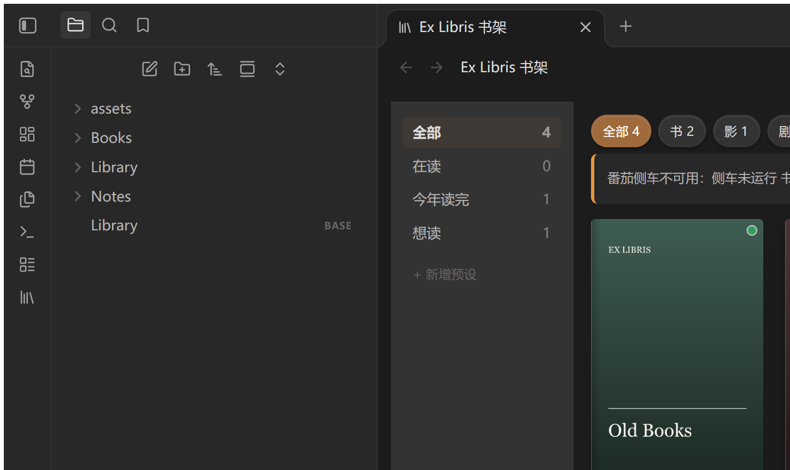
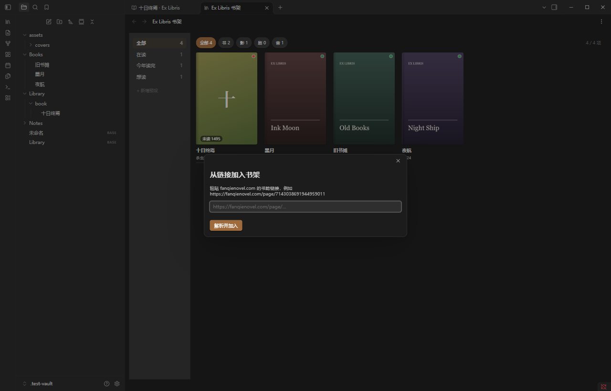
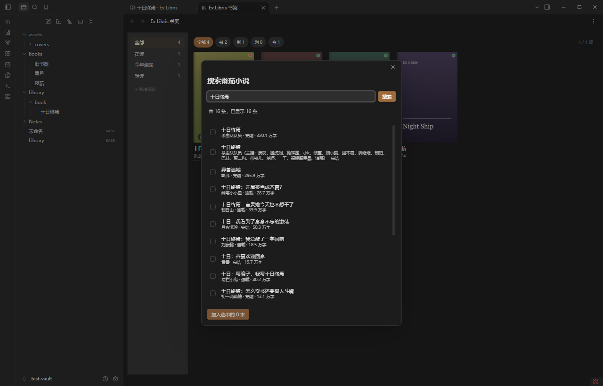
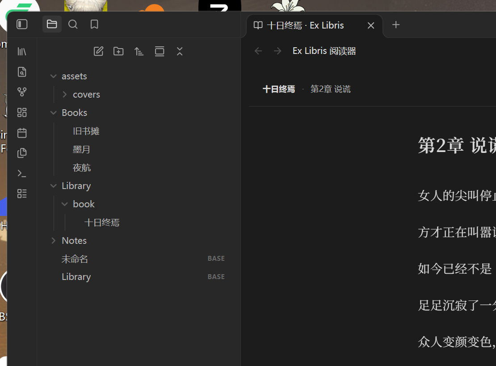

# Ex Libris 藏书票 · 使用指南

> 面向“每天用它看书”的场景。开发、构建、上游原理见 [README](../README.md)。



---

## 0. 五分钟上手

1. `Ctrl+P` 打开命令面板，输入 `Ex Libris`，运行 **打开书架**。
2. 书架是空的？正常——它只认 frontmatter。二选一：
   - 豆瓣：先运行 `obsidian-douban` 的导入；
   - 番茄：`Ctrl+P` → **从链接加入书架**，粘贴 `https://fanqienovel.com/page/<id>`。
3. 点封面：豆瓣条目打开笔记，番茄条目打开阅读器。
4. 阅读器里选中一句 → `Ctrl+Shift+E` → 选一条笔记 → 摘录带着出处和回跳链接写进去。

---

## 1. 确认插件在工作

设置 → 第三方插件 → 应看到 **Ex Libris 藏书票** 已启用。

设置 → Ex Libris → 顶部有侧车状态：

| 显示 | 含义 |
|---|---|
| `侧车就绪 · 127.0.0.1:<端口>` | 番茄功能可用 |
| `侧车未运行` / `侧车已关闭` | 番茄入口不可用，书架与豆瓣正常 |
| `未找到侧车：…` | 缺 `bin/fqsidecar.exe`，重新安装或编译 |
| 下面出现 20 行 stderr | 侧车崩溃原因，先看这里 |

侧车空闲 5 分钟会自动退出省内存；下次打开番茄书时自动拉起，不用管。

---

## 2. 书架界面

```
┌─────────────┬──────────────────────────────────────┐
│ 全部    42  │  全部 42   书 30   影 8   剧 3   音 1 │
│ 在读     3  │                                      │
│ 今年读完 7  │   [封面] [封面] [封面] [封面]          │
│ 想读     5  │   书名    书名    书名    书名          │
│ + 新增预设  │   作者·年 作者·年 作者·年 作者·年      │
└─────────────┴──────────────────────────────────────┘
```

- **左侧预设**：全部 / 在读 / 今年读完 / 想读，数字是条目数。
  - 也可以右键自定义预设 → **删除预设**（内置四个删不掉）。
- **顶部筛选片**：全部 / 书 / 小说 / 影 / 剧 / 音，后面是数量；番茄小说归入「小说」，不混进「书」。
- **封面**：
  - 左上角书脊是装饰；右上角小圆点表示来源：绿=豆瓣、红=番茄、双点=两边都有。
  - 左下角 `未读 3` 是番茄未读章数。
  - 封面下面一条 2px 进度条，来自番茄的 `fq_progress`。
  - 没有封面时用书名首字 + 稳定色块，不会留白框。
- **点击**：
  - 豆瓣条目 → 打开对应笔记；
  - 番茄条目 → 打开阅读器（侧车不可用时先打开笔记并提示）；
  - 右键 → 打开阅读器 / 打开笔记 / 关联豆瓣条目。

### 看书架里的条目来自哪

| 来源 | 笔记 | 谁写 frontmatter |
|---|---|---|
| 豆瓣 | 你已有的豆瓣笔记 | `obsidian-douban`，本插件只读 |
| 番茄 | `<书架根目录>/book/<书名>.md` | 本插件（轻笔记，只有元信息） |

普通笔记不会出现在书架上。

---

## 3. 添加内容

先确认两件事：

- **豆瓣条目**：用 `obsidian-douban` 导入，不需要侧车。
- **番茄书**：设置 → Ex Libris 显示“侧车就绪”。没有侧车时只能加书、不能读正文。

### 3.1 番茄 · 从链接加入（最快）



1. `Ctrl+P` → **Ex Libris: 从链接加入书架**
2. 粘贴链接，例如：

   ```
   https://fanqienovel.com/page/7143038691944959011
   ```

   也可以直接粘贴整段分享文案，插件会提取里面第一个 URL。
3. 回车或点 **解析并加入**。

插件会依次做：

- 从链接解析书籍 id
- 向番茄拉详情（书名、作者、封面、字数、连载状态、总章数）
- 把封面下载到 `<书架根目录>/assets/covers/fanqie-<id>.jpg`
- 在 `<书架根目录>/book/<书名>.md` 建一条轻笔记（只有 frontmatter，不写正文）

**重复加入**：如果书架上已有同一 `fq_book_id`，会跳过，不覆盖你改过的 `status`、`fq_related` 等字段。

### 3.2 番茄 · 搜索与批量加入



书架右上角的 **＋ 添加番茄书**，或 `Ctrl+P` → **Ex Libris: 搜索番茄小说并加入**。

1. 输入书名/作者，回车
3. 勾选一本或多本 → 点底部 **加入选中的 N 本**
   - 单本也可以右键 → **加入书架**
   - 部分结果（如“原创解读”、有声书）也会出现在列表里，按标题和作者自己挑
4. 底部会提示“新增 N 本，跳过 M 本（已在书架）”

默认每页 20 条，列表底部有 **加载更多**。

### 3.3 豆瓣（可直接搜索加入）

不需要 `obsidian-douban`，也不需要侧车。

1. 书架工具栏 **＋ 豆瓣**，或 `Ctrl+P` → **Ex Libris: 搜索豆瓣并加入**
2. 选择 **书** 或 **影 · 剧**
3. 输入书名/电影名/剧名，回车或点“搜索”
4. 勾选一条或多条 → **加入选中的 N 项**；右键单条 → **加入书架**

插件会写入 `<书架根目录>/douban/<标题>.md`，封面放到
`<书架根目录>/assets/covers/douban-<id>.jpg`，默认状态 `想读` / `想看`。

限制：

- 用的是豆瓣公开搜索建议接口（页面抓取，不是官方 API），**可能限流**；失败时等几分钟再试。
- 音乐搜索暂不支持。
- 同一 `id` 已在书架会跳过；同名不同书会加 id 后缀。

已经有 `obsidian-douban` 的条目不需要重复加，本插件会继续识别；两种方式可以共存。

### 3.3b 手写豆瓣 frontmatter

Ex Libris 不登录豆瓣，只读 frontmatter。没有 `obsidian-douban` 也能手动建条目：

```yaml
---
type: book
id: "manual-1"
title: 某本书
myState: 想读
cover: assets/covers/some-book.jpg
---
```

`id` 或 `myState`/`myRating` 有一个就能被识别为豆瓣条目；`type` 支持
`book` / `movie` / `tv` / `music`。`cover` 是 vault 内路径（可选）。

### 3.3c 联动 obsidian-douban（可选）

如果你已经在用 [`obsidian-douban`](https://github.com/Wanxp/obsidian-douban) 管理豆瓣收藏，
可以让 Ex Libris 直接读取它导入的条目，不必重复添加。

#### 开启

1. 安装并登录 `obsidian-douban`，导入“我标记过的书影音”；
2. 打开 Ex Libris 设置 → **联动 obsidian-douban**（默认开启）；
3. 回到书架，条目会自动出现（必要时执行 **重建书架缓存**）。

关闭这个开关后，书架只显示番茄条目和**内建豆瓣搜索**添加的条目；
`obsidian-douban` 导入的条目会被隐藏，但笔记本身不动。

#### Ex Libris 读取的字段

| frontmatter | 用途 |
|---|---|
| `type` | `book` / `movie` / `tv` / `music`，缺省按书 |
| `id` | 豆瓣条目 id；有 `id` 或 `myState`/`myRating` 就会识别 |
| `title` | 书名/片名；缺省用文件名 |
| `author` / `publisher` | 作者；没有 `author` 时用 `publisher` |
| `myState` | 想读/在读/读完/想看/在看/看完等 |
| `myRating` | 评分（0–5） |
| `cover` | vault 内封面路径 |
| `imageData` | 远程封面 URL 或图片数据（兜底） |
| `datePublished` / `myCollectionDate` | 年份与排序 |
| `fq_related` | 关联的番茄书（只读） |

Ex Libris **只读**，不会修改豆瓣笔记、不会同步评分/短评，也不处理豆瓣广播/日记。

#### 和内建豆瓣搜索共存

| 情况 | 结果 |
|---|---|
| 同一个 `id` 已由内建搜索添加 | 再次添加会跳过 |
| 同一本书既有 douban 笔记又有内建条目 | 可能显示两条（不同笔记路径）；删掉一条即可 |
| 关闭联动 | 只隐藏 `obsidian-douban` 的条目；内建条目有 `ex_libris: douban-search`，保留 |
| 删除 douban 笔记 | 书架条目随之消失（书架只读 frontmatter） |

建议：

- 想保留**自己的评分/状态/短评** → 用 `obsidian-douban` 联动；
- 只想快速搜一本、不想登录 → 用内建豆瓣搜索；
- 两者都用时，同一本书只保留一条笔记，避免重复。

#### 常见问题

| 现象 | 处理 |
|---|---|
| 开启后书架没变化 | 确认导入的笔记有 `id` 或 `myState`；执行“重建书架缓存” |
| 条目显示但没封面 | douban 笔记的 `cover` 为空或路径不对；补 `cover` 或 `imageData` |
| 只想看番茄 | 关闭“联动 obsidian-douban” |
| 状态不显示 | `myState` 用了不支持的值；改成 想读/在读/读完/想看/在看/看完 |

### 3.4 加入之后

| 事项 | 位置/行为 |
|---|---|
| 番茄笔记 | `<书架根目录>/book/<书名>.md`，默认 `Library/book/` |
| 封面 | `<书架根目录>/assets/covers/` |
| 默认状态 | `status: 在追` |
| 未读数 | 先按总章数填 `fq_unread_count`，打开书架/阅读后校正 |
| 正文 | 不落盘；只在 `cache/` 与显式导出目录 |
| 重名 | 已存在同书 → 跳过；同书名不同书 → 文件名加 id 后缀 |

加完在书架没看到：

1. 切走再切回书架；
2. `Ctrl+P` → **Ex Libris: 重建书架缓存**；
3. 确认笔记有 `source: fanqie` 和 `fq_book_id`，且没有被移出 vault。

### 3.5 新书 vs 连载更新

这是两件不同的事：

- **加一本新书**：用上面的链接/搜索/豆瓣。
- **连载书出了新章节**：书已经在书架里，不需要重新加。

拿最新章节：

- `Ctrl+P` → **Ex Libris: 刷新当前书目录**（阅读器里刷当前书；否则选一本）；
- 或设置 → Ex Libris → **目录刷新间隔** 改为 `0`，每次打开都重新拉目录。

目录默认缓存 30 分钟。正文按章缓存，已读章节不会因为作者改文而重新下载；
需要时清 `cache/` 或等 7 天自动清理。

### 3.6 常见失败

| 现象 | 原因/处理 |
|---|---|
| 提示“侧车未就绪” | 设置页点“重启并检查”；确认 `bin/fqsidecar.exe` 存在 |
| 链接解析不出 id | 链接里没有 6 位以上数字；换 `fanqienovel.com/page/<id>` |
| 搜索没有结果 | 换书名/作者；番茄接口可能限流，稍后重试 |
| 加入成功但书架空 | 重建书架缓存；确认 `libraryRoot` 指向的目录 |
| 封面不显示 | 封面下载失败时 `cover` 为空，会显示占位封面；可手动补 `cover` |
| 书重复 | 已在书架会跳过；不要手动改 `fq_book_id` 来绕过去 |

### 3.7 手动挂靠豆瓣

番茄条目右键 → **关联豆瓣条目**（或命令面板同名命令）→ 选一条豆瓣笔记。

只写番茄笔记的 `fq_related: "[[某书]]"`，**不会**自动匹配，也不会改豆瓣笔记。

---

## 4. 阅读番茄



- 顶部：书名 · 章名，右边 **导出本章** / **书评**。
- 正文：单栏最大 38em，衬线字体，段首缩进由排版自动处理。
- 底部：上一章 / 下一章，中间“第 x / y 章”。

### 快捷键

| 键 | 作用 |
|---|---|
| `←` / `→` | 上一章 / 下一章 |
| `j` / `k` | 下一章 / 上一章 |
| `Ctrl+E` | 导出本章 |
| `Ctrl+Shift+E` | 摘录选中文字 |

> 快捷键只在阅读器是当前标签页时生效，不会抢编辑器里的按键。

### 断点续读

- 滚动位置 5 秒节流写进 `data/progress.json`，**不写笔记**。
- 换章、退出阅读器、卸载插件时，摘要写回 frontmatter：
  `fq_reading_chapter`、`fq_progress`、`fq_last_read_at`。
- 下次打开同一本书，以 `progress.json` 为准定位；如果和 frontmatter 不一致，会顺手纠正。
- 打开书架时，对 `status: 在追` 的番茄书刷新未读章数（目录 30 分钟节流）。

### 书评（只读）

阅读器 → **书评**，右侧面板：

- 上游书评，只读：没有输入框、不能点赞/回复。
- 分页懒加载，滚到底自动下一页；失败只显示“书评暂不可用”，不影响正文。
- 显示的是**书评**，不是段评。番茄段评接口需要正文的 `item_version`，拿不到内容；
  为了不骗人，面板就叫“书评”。

---

## 5. 摘录与回跳（最值钱的功能）

1. 阅读器里选中一句话或一段。
2. `Ctrl+Shift+E`。
3. 在弹出的模糊搜索里选目标笔记（按最近修改排序）。
4. 插件把下面这块插到该笔记的 `## 摘录` 标题下；没有这个标题就在文末新建：

```markdown
> [!quote] 摘录
> 正文一段……
> — 《十日终焉》· 第 1 章 空屋 · [回跳](obsidian://ex-libris?book=7143038691944959011&chapter=1)
```

- 摘录上限 **800 字**，超出截断并弹提示。
- 回跳链接里的 `chapter` 是 **1 基章序号**（`chapter=1` 就是第一章）。
- 点回跳会打开阅读器并定位到该章；目录被作者改过导致定位失败时，会提示并打开书。
- 用 `Vault.process()` 原子写入，不会写坏笔记。

---

## 6. 导出

只有“显式导出”会把正文写进 vault：

- 阅读器里 `Ctrl+E` 或 **导出本章**：导出当前章。
- 命令面板 **导出整本番茄书**：选一本书，逐章导出。

路径：`<导出目录>/<书名>/<编号> - <章名>.md`，默认 `Library/exports`。
重复导出会覆盖同名文件；导出过程中有 Notice 进度，侧车不可用会中止并提示。

---

## 7. 书架预设

`Ctrl+P` → **添加书架预设**：

| 字段 | 值示例 | 含义 |
|---|---|---|
| 状态 | 在读 / 想读 / 归档 | 匹配 frontmatter 的 `status`（番茄）或 `myState`（豆瓣） |
| 类型 | book / novel / movie / tv / music | 匹配 `type` |
| 来源 | douban / fanqie / both | 匹配来源 |
| 标签 | 科幻 | 匹配 `tags` |

自定义预设存在 `data/meta.json`，名字和值都可以中文。

内置预设的行为：

- **在读**：状态是在读/在看/在追，或番茄进度在 0–100 之间；
- **今年读完**：状态读完/看过，且最近活动时间在今年；
- **想读**：状态想读/想看。

---

## 8. 设置项

| 设置 | 默认 | 说明 |
|---|---|---|
| 书架根目录 | `Library` | 番茄笔记写到这里 |
| 封面宽度 | 140 | 100–220 px |
| 显示阅读进度 | 开 | 封面下 2px 进度条 |
| 缓存自动清理 | 7 天 | 0 关闭；只清 `cache/` |
| 目录刷新间隔 | 30 分钟 | 0 = 每次打开都重新拉目录 |
| 联动 obsidian-douban | 开 | 读取其导入的豆瓣条目；关闭后只保留番茄与内建豆瓣条目 |
| 远程封面本地化 | 开 | 后台最多 2 并发下载 |
| 导出目录 | `Library/exports` | 显式导出位置 |
| 启动时打开书架 | 关 | 启动后自动开书架 |
| 启用番茄侧车 | 开 | 关闭后书架/豆瓣照常 |
| 侧车路径覆盖 | 空 | 留空用插件目录 `bin/fqsidecar.exe` |
| 重启并检查 | — | 重启侧车并显示 `/health` 与 stderr |
| 立即清理缓存 | — | 只动 `cache/`，不动 `data/` 与笔记 |
| 本地化所有远程封面 | — | 断网也能显示封面 |

> 清理缓存永远不会删除：`data/`、vault 笔记、番茄笔记里的封面附件。

---

## 9. 在 Bases 里用

新建一个 `.base` 文件，视图类型选 **Ex Libris 书架**：

```yaml
filters:
  and:
    - file.ext == "md"
views:
  - type: ex-libris-shelf
    name: Ex Libris 书架
```

视图选项：`coverWidth`（100–220）、`showProgress`（开关）。
示例文件：[examples/Library.base](../examples/Library.base)。

Bases 视图和书架 ItemView 读的是同一份 `ShelfItem[]`，外观一致。
若 Obsidian 版本低于 1.10 或 `registerBasesView` 失败，插件只在控制台警告，
书架 ItemView 不受影响。

---

## 10. 数据、隐私与备份

```
<vault>/.obsidian/plugins/ex-libris/
  bin/fqsidecar.exe      # 侧车
  data/progress.json     # 阅读位置
  data/meta.json         # 清理时间、预设、侧车状态、stderr 尾巴
  data/device_pool.json  # 侧车设备池（首次读番茄后出现）
  cache/chapters/**      # 正文缓存（可删）
  cache/toc/*.json       # 目录缓存（可删）
  cache/covers/**        # 远程封面缓存（可删）
```

- **token 不落盘**：每次启动随机生成，只通过环境变量传给侧车。
- 插件不登录豆瓣、不处理 Cookie；番茄也不登录，只做匿名设备注册。
- 正文只在 `cache/` 和显式导出目录，vault 笔记里只有 frontmatter；
  所以在 Obsidian 里 `Ctrl+F` 搜不到小说正文，这是设计。
- 侧车只监听 `127.0.0.1`，不写注册表、不建托盘、不弹窗。
- 备份只需要：笔记本身 + `data/`（尤其 `progress.json` 和 `device_pool.json`）。
  `cache/` 随时可删，删了会自动重建。

---

## 11. 常见问题

**书架是空的？**
只认 frontmatter。先 `obsidian-douban` 导入，或用“从链接 / 搜索”加番茄书。
普通笔记不会进书架。

**番茄入口是灰的 / 点了打不开阅读器？**
侧车没起来。设置页看“重启并检查”的输出；常见是 `bin/fqsidecar.exe` 被删了
（更新插件时只拷了 `main.js`），重新运行安装脚本即可。

**阅读器空白、标题只有“Ex Libris 阅读器”？**
不要手改 `workspace.json`。从书架点书，或命令面板/回跳链接打开。
如果是从旧会话恢复的空白页，关掉标签页重新打开。

**点了回跳，提示找不到章节？**
链接里是 1 基章序号，作者删改章节会导致偏移。仍会打开书，手动翻一下即可。
章节 id 形式的链接不受影响。

**为什么 `Ctrl+F` 搜不到正文？**
正文在 `cache/`，不在笔记里。这是隐私设计。

**书评面板是空的？**
上游可能限流或改版；正文不受影响。过一会儿或重启侧车再试。

**读番茄时报 `UPSTREAM_TIMEOUT` / `DECRYPT_FAILED`？**
侧车在，但上游变了。到 [ex-libris-sidecar](https://github.com/Yolkbun/ex-libris-sidecar)
更新 `vendor/fqapp` 后重编侧车；插件本身不用动。

**删掉 `cache/` 会怎样？**
没事：下次读会重新拉，封面重新缓存；`data/` 和笔记不受影响。

**能多端同步吗？**
笔记可以，`cache/` 与 `data/device_pool.json` 不建议同步；`progress.json` 可以。
侧车是 Windows exe，移动端不支持。

---

## 12. 更新与维护

- **只更新插件**：替换 `main.js` / `manifest.json` / `styles.css`，保留 `data/` 与 `bin/`；
  重启 Obsidian。
- **更新侧车**：用新的 `bin/fqsidecar.exe` 替换，重启 Obsidian（或设置里重启侧车）。
- **重新编译侧车**：见 [README](../README.md) 的“重新编译侧车”，需要 Rust + GNU 链接器。
- **检查状态**：设置页“重启并检查”，或看 `data/meta.json` 里的
  `lastBootAt` / `sidecarState` / `sidecarReason`。

---

## 附：命令一览

| 命令 | 用途 |
|---|---|
| 打开书架 | 打开书架视图 |
| 从链接加入书架 | 粘贴番茄链接 |
| 搜索番茄小说并加入 | 搜索 + 批量勾选 |
| 导出当前章节 | 阅读器内导出 |
| 导出整本番茄书 | 逐章导出 |
| 把番茄书挂靠到豆瓣条目 | 手动关联 |
| 添加书架预设 | 状态/类型/来源/标签 |
| 重启番茄侧车 | 重启 + 健康检查 |
| 刷新当前书目录 | 立即重拉当前/选中番茄书的目录 |
| 本地化所有远程封面 | 断网可读 |
| 清理章节与封面缓存 | 只清 `cache/` |
| 重建书架缓存 | 重扫 frontmatter |
